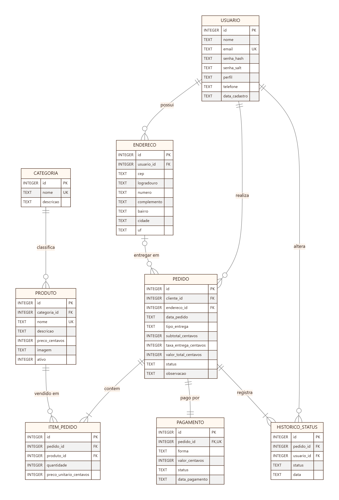

# Banco de dados

**SGBD:** SQLite 3 (versão embarcada no [sql.js 1.10.3](https://github.com/sql-js/sql.js), WebAssembly)
**Script físico:** [`app/db/schema.sql`](../../app/db/schema.sql) · **Carga inicial:** [`app/db/dados-iniciais.sql`](../../app/db/dados-iniciais.sql)

Escolhi o SQLite porque é um banco relacional bem conhecido, não precisa de servidor e tem tudo o que o projeto pedia: chave estrangeira, `CHECK`, índice e transação. Com ele o mesmo banco roda no navegador (no GitHub Pages) e nos testes automáticos (no Node.js). Depois de cada gravação, o arquivo do banco é salvo no `localStorage` do navegador.

## 1. Projeto conceitual

Partindo do diagrama de classes, cheguei nestas entidades e relações:

- **Usuário** (cliente ou membro da equipe) **possui** endereços e **realiza** pedidos.
- **Categoria** **classifica** produtos (1:N).
- **Pedido** **contém** itens (1:N), **é pago por** um pagamento (1:1), **registra** mudanças de status (1:N) e pode **ser entregue em** um endereço (N:1, opcional).
- **Produto** **é vendido em** itens de pedido (1:N).
- **Usuário** **altera** status de pedidos (1:N, via histórico).

O carrinho não é entidade do banco: é um estado temporário do navegador até o pedido ser confirmado.

## 2. Projeto lógico (normalizado)



### Normalização
- **1FN:** todos os atributos são atômicos (endereço separado em CEP, logradouro, número etc.; itens do pedido em tabela própria em vez de lista).
- **2FN:** as tabelas usam chave primária simples (`id`), então não há dependência parcial; em `item_pedido`, quantidade e preço dependem do par pedido/produto, garantido por `UNIQUE (pedido_id, produto_id)`.
- **3FN:** não há dependências transitivas — nome da categoria fica em `categoria`, dados do cliente em `usuario`, forma e status de pagamento em `pagamento`.
- **Desnormalizações conscientes:** `item_pedido.preco_unitario_centavos` (preserva o preço histórico — RN12) e `pedido.subtotal/taxa/valor_total_centavos` (valores congelados no momento da compra, para auditoria e relatório).

## 3. Projeto físico

Principais restrições implementadas no `schema.sql`:

| Restrição | Exemplo | Regra |
|---|---|---|
| `PRIMARY KEY AUTOINCREMENT` | todas as tabelas | RN07 |
| `FOREIGN KEY` + `PRAGMA foreign_keys = ON` | `item_pedido.produto_id → produto.id` | Integridade referencial |
| `UNIQUE` | `usuario.email` (sem diferenciar maiúsculas), `produto.nome`, `pagamento.pedido_id` | E-mail único; 1 pagamento por pedido |
| `CHECK` de domínio | `perfil IN (...)`, `status IN (...)`, `tipo_entrega IN ('ENTREGA','RETIRADA')` | Enumerações do diagrama de classes |
| `CHECK` de faixa | `preco_centavos BETWEEN 100 AND 100000`, `quantidade BETWEEN 1 AND 20` | Validação também no banco |
| `CHECK` entre colunas | `tipo_entrega = 'RETIRADA' OR endereco_id IS NOT NULL` | RN06 |
| `ON DELETE CASCADE` | itens, pagamento e histórico de um pedido | Composição |
| Índices | `idx_pedido_cliente`, `idx_pedido_data`, `idx_produto_categoria`… | Consultas de histórico e relatório |
| `PRAGMA user_version = 1` | versão do esquema | Recriação segura se o esquema mudar |

## 4. Dicionário de dados

Convenções: `INTEGER` monetário em **centavos**; datas em texto ISO-8601 UTC (`2026-11-04T18:30:00.000Z`); `PK` chave primária; `FK` chave estrangeira; `NN` obrigatório.

### usuario
| Coluna | Tipo | Restrições | Descrição |
|---|---|---|---|
| id | INTEGER | PK | Identificador |
| nome | TEXT | NN, 3–100 caracteres | Nome completo |
| email | TEXT | NN, UNIQUE (NOCASE), ≤ 120 | Login do usuário, guardado em minúsculas |
| senha_hash | TEXT | NN | PBKDF2-SHA-256, 120.000 iterações, 256 bits (hex) |
| senha_salt | TEXT | NN | Salt aleatório de 16 bytes (hex), um por usuário |
| perfil | TEXT | NN, CHECK | CLIENTE, ATENDENTE, ADMINISTRADOR ou GESTOR (padrão CLIENTE) |
| telefone | TEXT | 10–11 dígitos ou nulo | Celular com DDD, só dígitos |
| data_cadastro | TEXT | NN | Data/hora do cadastro |

### categoria
| Coluna | Tipo | Restrições | Descrição |
|---|---|---|---|
| id | INTEGER | PK | Identificador |
| nome | TEXT | NN, UNIQUE, 3–60 | Ex.: Clássicos |
| descricao | TEXT | — | Texto de apoio |

### produto
| Coluna | Tipo | Restrições | Descrição |
|---|---|---|---|
| id | INTEGER | PK | Identificador |
| categoria_id | INTEGER | FK → categoria, NN | Categoria do cupcake |
| nome | TEXT | NN, UNIQUE, 3–80 | Nome do sabor |
| descricao | TEXT | NN, 10–400 | Descrição exibida no cardápio |
| preco_centavos | INTEGER | NN, 100–100000 | Preço unitário atual |
| imagem | TEXT | NN | Caminho relativo da imagem (lista permitida no Model) |
| ativo | INTEGER | NN, 0 ou 1 | 1 = disponível; 0 = indisponível (não apaga o histórico) |

### endereco
| Coluna | Tipo | Restrições | Descrição |
|---|---|---|---|
| id | INTEGER | PK | Identificador |
| usuario_id | INTEGER | FK → usuario, NN | Dono do endereço |
| cep | TEXT | NN, 8 dígitos | CEP sem máscara |
| logradouro | TEXT | NN | Rua/avenida |
| numero | TEXT | NN | Número ou “s/n” |
| complemento | TEXT | — | Opcional |
| bairro, cidade | TEXT | NN | Localização |
| uf | TEXT | NN, 2 letras | Sigla validada contra as 27 UFs |

### pedido
| Coluna | Tipo | Restrições | Descrição |
|---|---|---|---|
| id | INTEGER | PK | Número do pedido (exibido como #00001) |
| cliente_id | INTEGER | FK → usuario, NN | Quem comprou |
| data_pedido | TEXT | NN | Data/hora da compra |
| tipo_entrega | TEXT | NN, CHECK | ENTREGA ou RETIRADA |
| endereco_id | INTEGER | FK → endereco; obrigatório se ENTREGA | Endereço de entrega |
| subtotal_centavos | INTEGER | NN, > 0 | Soma dos itens |
| taxa_entrega_centavos | INTEGER | NN, ≥ 0 | 800 na entrega, 0 na retirada |
| valor_total_centavos | INTEGER | NN, > 0 | Subtotal + taxa |
| status | TEXT | NN, CHECK | RECEBIDO, EM_PREPARACAO, PRONTO, SAIU_PARA_ENTREGA, CONCLUIDO, CANCELADO |
| observacao | TEXT | ≤ 300 | Observação do cliente |

### item_pedido
| Coluna | Tipo | Restrições | Descrição |
|---|---|---|---|
| id | INTEGER | PK | Identificador |
| pedido_id | INTEGER | FK → pedido (CASCADE), NN | Pedido |
| produto_id | INTEGER | FK → produto, NN | Produto vendido |
| quantidade | INTEGER | NN, 1–20 | Unidades |
| preco_unitario_centavos | INTEGER | NN, > 0 | Preço congelado na compra (RN12) |
| — | — | UNIQUE (pedido_id, produto_id) | Um item por produto em cada pedido |

### pagamento
| Coluna | Tipo | Restrições | Descrição |
|---|---|---|---|
| id | INTEGER | PK | Identificador |
| pedido_id | INTEGER | FK → pedido (CASCADE), NN, UNIQUE | Um pagamento por pedido |
| forma | TEXT | NN, CHECK | PIX, CARTAO ou DINHEIRO |
| valor_centavos | INTEGER | NN, > 0 | Valor do pedido |
| status | TEXT | NN, CHECK | PENDENTE, APROVADO (simulado) ou RECUSADO |
| data_pagamento | TEXT | NN | Data do registro |

### historico_status
| Coluna | Tipo | Restrições | Descrição |
|---|---|---|---|
| id | INTEGER | PK | Identificador |
| pedido_id | INTEGER | FK → pedido (CASCADE), NN | Pedido |
| status | TEXT | NN | Status atribuído |
| data | TEXT | NN | Quando mudou |
| usuario_id | INTEGER | FK → usuario, NN | Quem mudou (cliente na criação; equipe nas demais) |

## 5. Consultas principais (todas parametrizadas)

```sql
-- Histórico do cliente (RN08)
SELECT p.id, p.data_pedido, p.status, p.valor_total_centavos
FROM pedido p WHERE p.cliente_id = ? ORDER BY p.data_pedido DESC;

-- Faturamento do período, sem cancelados (HU13)
SELECT COUNT(*), SUM(CASE WHEN status <> 'CANCELADO' THEN valor_total_centavos END)
FROM pedido p WHERE p.data_pedido >= ? AND p.data_pedido <= ?;
```
