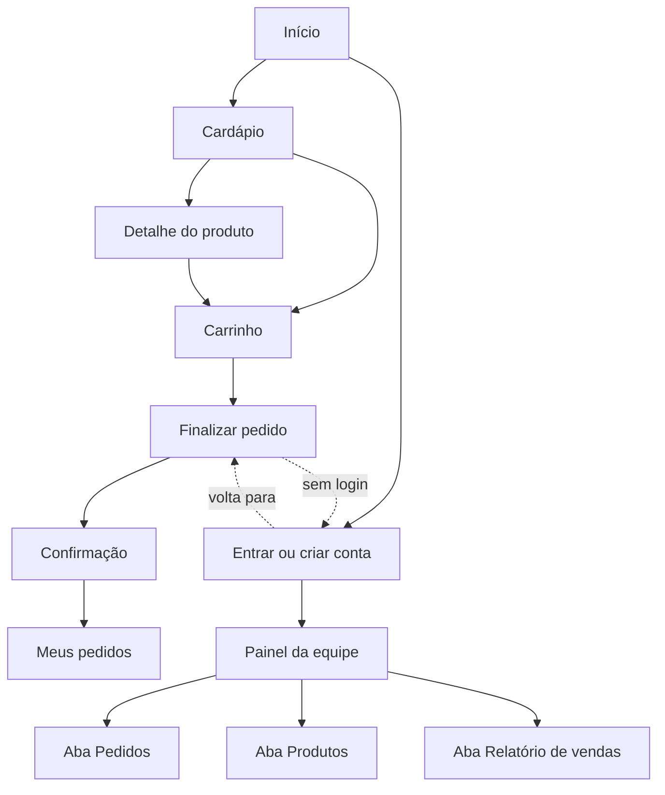

# Interface Humano-Computador (IHC)

## Mapa do site

| Página | Arquivo | Público | Indexável |
|---|---|---|---|
| Início | `index.html` | Todos | Sim |
| Cardápio | `cardapio.html` | Todos | Sim |
| Detalhe do produto | `produto.html?id=N` | Todos | Não (conteúdo repetido do cardápio) |
| Carrinho | `carrinho.html` | Todos | Não |
| Finalizar pedido | `checkout.html` | Cliente autenticado | Não |
| Entrar ou criar conta | `entrar.html` | Todos | Não |
| Meus pedidos | `pedidos.html` | Usuário autenticado | Não |
| Painel da equipe | `painel.html` | Atendente, administrador, gestor | Não |
| Página não encontrada | `404.html` | Todos | Não |

## Direção visual

- **Conceito:** confeitaria artesanal acolhedora — fundo creme, texto cacau e destaque framboesa, que remetem a massa, chocolate e frutas vermelhas.
- **Tipografia:** *Fraunces* (serifada macia, com eixo óptico) nos títulos, transmitindo artesanal/premium; *Nunito Sans* (arredondada e muito legível) no texto. Escala fluida com `clamp()`: display 36–62 px, H1 30–42 px, H2 23–31 px, corpo 17 px, apoio 15 px, micro 13 px. Linhas de leitura limitadas a ~62 caracteres.
- **Cores e contraste (medidos sobre o fundo #FFF8F0):** texto #2E1B12 (15,9:1), texto secundário #66493A (7,6:1), botão framboesa #A61E4D com texto branco (7,2:1). A cor nunca é o único sinal: status têm texto e indisponibilidade tem etiqueta.
- **Imagens:** fotografias de produto com a mesma luz e fundo em todos os sabores, e ilustrações vetoriais (SVG) como alternativa leve.

## Telas e componentes

| Tela | Componentes principais | Estados tratados |
|---|---|---|
| Cardápio | Campo de pesquisa, chips de categoria (`aria-pressed`), cartões com preço e botão | Carregando, vazio (com orientação), produto indisponível |
| Detalhe | Trilha de navegação, imagem, preço, quantidade, botão adicionar | Produto inexistente, indisponível |
| Carrinho | Lista de itens, botões −/+ (44 px), remover, resumo fixo | Vazio, item indisponível (bloqueia finalização) |
| Checkout | Opções de recebimento e pagamento (cartões de opção), endereço com máscara de CEP, observação, resumo | Sem login (redireciona), conta da equipe, carrinho vazio, erros por campo, confirmação |
| Entrar | Formulário de login, formulário de cadastro, contas de demonstração | Credenciais inválidas, bloqueio temporário, e-mail duplicado, senhas diferentes, sucesso |
| Meus pedidos | Tabela de pedidos, detalhe com linha do tempo | Sem pedidos, pedido não encontrado |
| Painel | Abas acessíveis por teclado, filtros, tabelas, diálogo modal | Sem permissão, sem resultados, período inválido |

## Mensagens do sistema

| Situação | Mensagem exibida | Tipo |
|---|---|---|
| Login inválido | “E-mail ou senha inválidos.” (genérica, não revela se o e-mail existe) | Erro |
| Muitas tentativas de login | “Muitas tentativas. Aguarde N segundos e tente novamente.” | Erro |
| E-mail já cadastrado | “Este e-mail já está cadastrado.” | Erro no campo |
| Senha fraca | “A senha deve ter de 8 a 72 caracteres, com letras e números.” | Erro no campo |
| Senhas diferentes | “As senhas não conferem.” | Erro no campo |
| Cadastro concluído | “Conta criada com sucesso! Bem-vindo(a), Nome. Redirecionando…” | Sucesso |
| Produto adicionado | “Produto adicionado ao carrinho.” | Aviso (aria-live) |
| Produto indisponível | “Este produto está indisponível no momento.” | Erro |
| Quantidade inválida | “A quantidade deve ser de 1 a 20.” | Erro |
| Checkout sem login | “Entre na sua conta para continuar.” | Aviso |
| Endereço incompleto | “Preencha corretamente o endereço de entrega.” + mensagem em cada campo | Erro |
| Pedido confirmado | “Pedido #00003 confirmado! Total: R$ 35,80 · Pix (simulado) — Aprovado (simulado)” | Sucesso |
| Transição de status inválida | “Mudança de status não permitida para este pedido.” | Erro |
| Sem permissão | “Acesso restrito à equipe.” / “Você não tem permissão para esta ação.” | Permissão |
| Falha geral | “Não foi possível abrir a loja. Verifique sua conexão e recarregue a página.” | Erro |
| Armazenamento bloqueado | “Seu navegador bloqueou o armazenamento local: os dados serão perdidos ao fechar a página.” | Aviso |

## Princípios de usabilidade aplicados (material da disciplina)

- **Clara e simples:** uma ação principal por tela; rótulos persistentes; linguagem do dia a dia.
- **Consistente:** mesmos componentes (botões, chips, cartões, tabelas) em todo o site.
- **Controlada pelo usuário e reversível:** carrinho editável, remover item, desativação de produto reversível, confirmação antes de cancelar pedido.
- **Dá resposta:** contador do carrinho, avisos `aria-live`, linha do tempo do pedido, estados de carregamento.
- **Padrões inteligentes:** último endereço preenchido automaticamente; retorno à página de origem após o login; máscaras de CEP e telefone.

## Acessibilidade (meta WCAG 2.2 AA — não auditada formalmente)

Link “Pular para o conteúdo”, HTML semântico (`header`, `nav`, `main`, `footer`, `fieldset/legend`), rótulos em todos os campos, foco visível, navegação por teclado nas abas (setas), diálogos nativos (`<dialog>`), textos alternativos descritivos, alvos de toque ≥ 44 px, respeito a `prefers-reduced-motion` e layout sem rolagem horizontal em 375 px.
