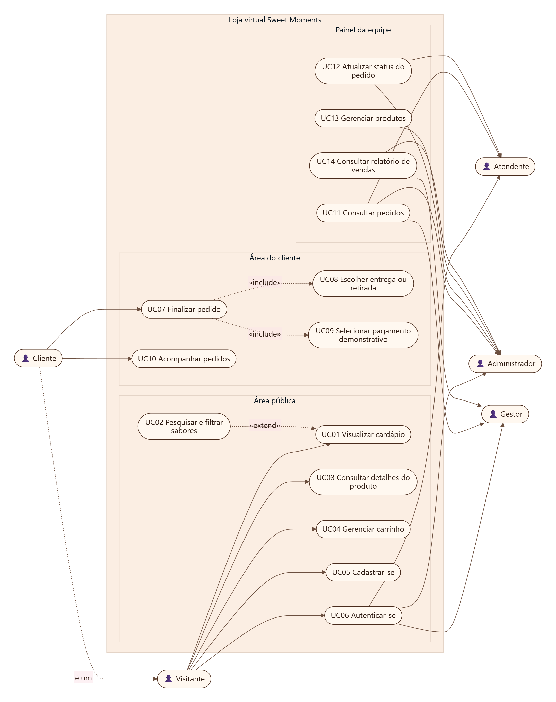
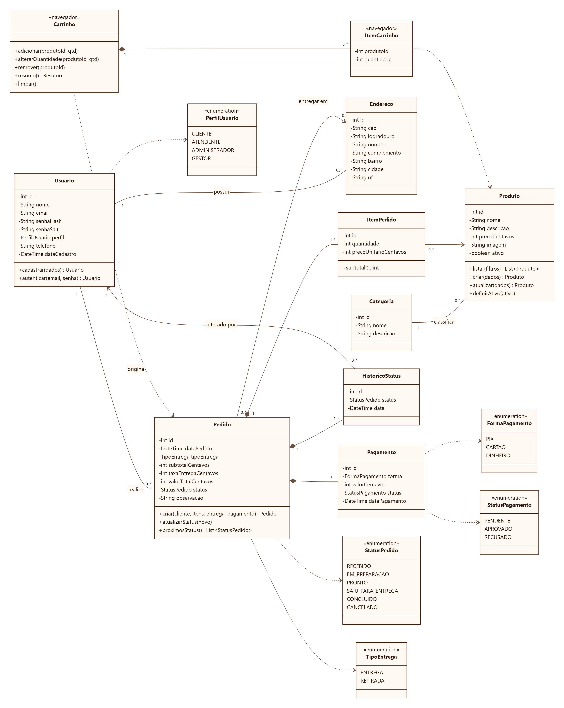
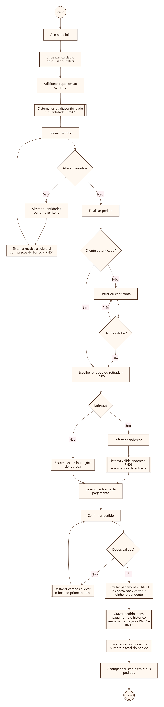
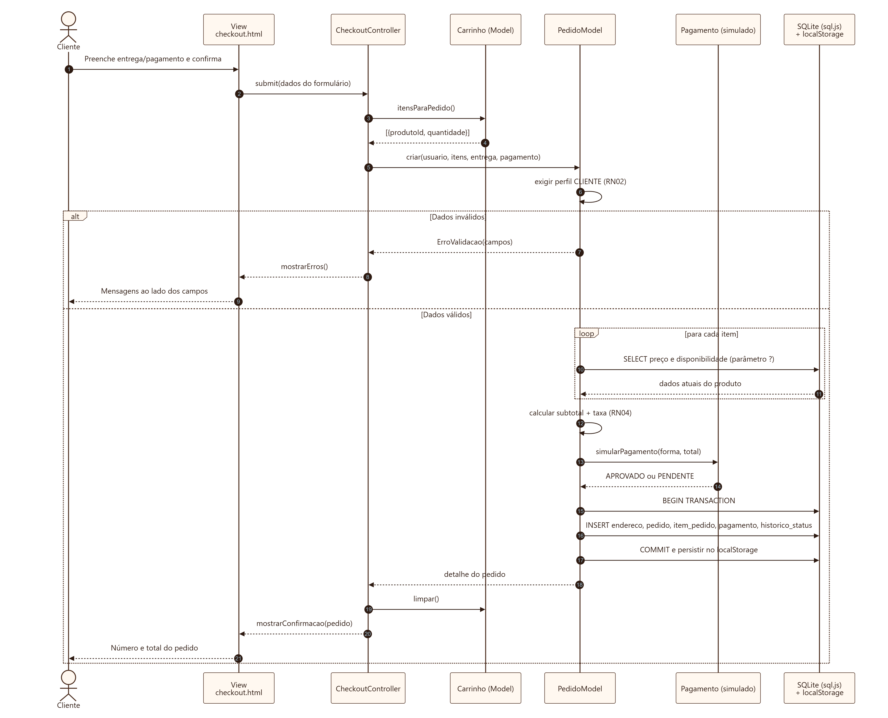
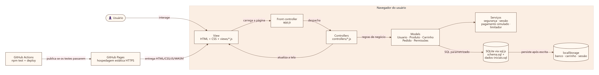

# Diagramas UML

Revisei os diagramas na PIT II pra eles baterem exatamente com o que foi construído. O código-fonte de cada diagrama está em [`diagramas/`](diagramas/) no formato **Mermaid** (`.mmd`), que pode ser editado em texto e é renderizado pelo GitHub; ao lado de cada fonte há a versão em imagem (`.png`).

| Diagrama | Fonte | Imagem |
|---|---|---|
| Casos de uso | [casos-de-uso.mmd](diagramas/casos-de-uso.mmd) | [PNG](diagramas/casos-de-uso.png) |
| Classes (domínio e persistência) | [classes.mmd](diagramas/classes.mmd) | [PNG](diagramas/classes.png) |
| Atividades — realização de pedido | [atividades-pedido.mmd](diagramas/atividades-pedido.mmd) | [PNG](diagramas/atividades-pedido.png) |
| Sequência — finalização de pedido | [sequencia-pedido.mmd](diagramas/sequencia-pedido.mmd) | [PNG](diagramas/sequencia-pedido.png) |
| Modelo lógico relacional (DER) | [der.mmd](diagramas/der.mmd) | [PNG](diagramas/der.png) |
| Arquitetura MVC | [arquitetura-mvc.mmd](diagramas/arquitetura-mvc.mmd) | [PNG](diagramas/arquitetura-mvc.png) |

## O que mudou em relação à PIT I

| Diagrama | Alteração | Motivo |
|---|---|---|
| Casos de uso | Inclusão do ator **Visitante** (generalização de Cliente), de **UC02 Pesquisar e filtrar sabores** («extend») e dos «include» de entrega e pagamento em *Finalizar pedido*; *Cadastrar/Editar/Desativar produto* agrupados em **Gerenciar produtos**. | O carrinho é usado antes do login; a pesquisa surgiu nos testes com usuários; menos casos de uso redundantes. |
| Classes | `Cliente` deixou de ser subclasse: o perfil é um atributo de `Usuario`. Criada `HistoricoStatus`. `Carrinho` e `ItemCarrinho` marcados como «navegador» (não são tabelas). Valores em centavos (`int`). | Uma tabela de usuários com perfil é mais simples e evita junções; o histórico permite a linha do tempo do pedido; centavos evitam erro de arredondamento. |
| Atividades | Removido o laço de “pagamento recusado / tentar novamente”; incluído o retorno ao checkout após o login e o foco no primeiro campo inválido. | O pagamento é demonstrativo (Pix aprovado; cartão e dinheiro pendentes até a entrega). |
| Sequência | Participantes passaram de Frontend → Flask → MySQL para **View → Controller → Model → SQLite**, com a transação explícita. | Nova arquitetura MVC estática (GitHub Pages). |
| Novos | Modelo lógico (DER) e diagrama de arquitetura. | Exigência de projeto de dados e documentação da arquitetura. |

## Casos de uso

São cinco atores. O **Visitante** navega pelo cardápio, consulta detalhes, monta o carrinho, cadastra-se e entra. O **Cliente** herda essas ações e pode finalizar o pedido — que inclui obrigatoriamente escolher entrega/retirada e a forma de pagamento — e acompanhar seus pedidos. Na equipe, o **Atendente** consulta pedidos e atualiza status; o **Administrador** faz isso e também gerencia produtos e vê o relatório; o **Gestor** consulta pedidos e o relatório, sem alterar dados. A separação por perfil implementa o princípio do menor privilégio (`js/models/permissoes.js`).

## Classes

`Usuario` concentra identificação, autenticação e perfil. `Produto` pertence a uma `Categoria` e pode ser desativado sem ser apagado, preservando o histórico de vendas. `Pedido` é composto por `ItemPedido` (com o preço copiado no momento da compra — RN12), um `Pagamento` e um ou mais registros de `HistoricoStatus`; pode apontar para um `Endereco` quando a modalidade é entrega. `Carrinho` e `ItemCarrinho` existem apenas no navegador e **originam** o pedido. As enumerações definem os domínios válidos de perfil, status, modalidade e pagamento, também garantidos por `CHECK` no banco.

## Atividades — realização de pedido

O fluxo mostra as decisões do processo de compra: alterar ou não o carrinho, exigência de login (com retorno automático ao checkout), escolha entre entrega e retirada, validação do endereço e dos demais dados e, por fim, a gravação atômica do pedido.

## Sequência — finalização de pedido

A View apenas coleta dados e exibe resultados; o `CheckoutController` coordena; o `PedidoModel` aplica as regras (RN02–RN06), busca preços atuais no banco, simula o pagamento e grava tudo em **uma transação** (`BEGIN … COMMIT`). Se qualquer passo falhar, nada é gravado (`ROLLBACK`) e o erro volta para a View com a indicação do campo.

## Arquitetura MVC

Detalhes em [../2-desenvolvimento/arquitetura.md](../2-desenvolvimento/arquitetura.md).
