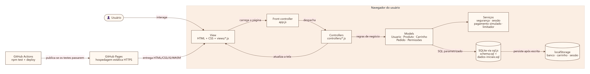

# Arquitetura e codificação



## Visão geral

| Item | Escolha |
|---|---|
| Plataforma | Web responsiva (celular, tablet e computador) |
| Modo de codificação | Tradicional (código escrito à mão, sem plataformas no-code/low-code) |
| Front-end | HTML5, CSS3 e JavaScript (ES Modules), sem frameworks |
| Back-end / lógica de negócio | JavaScript em camadas **Model** e **Controller** (padrão MVC), executado no navegador |
| Banco de dados | SQLite 3 via sql.js (WebAssembly) |
| Testes | `node:test` (Node.js 20+), sem dependências |
| Hospedagem | GitHub Pages (HTTPS), publicação pelo GitHub Actions após os testes |

### Por que não há um servidor?

O GitHub Pages serve apenas arquivos estáticos. Para manter a solução gratuita, simples e sempre disponível para tutores e testadores, o “back-end” — regras de negócio, validações, autorização e acesso a dados — roda no próprio navegador, isolado em Models e Controllers. O banco é um SQLite real, criado a partir do `schema.sql`.

**Limitação consciente:** como tudo roda no navegador, cada visitante tem o **seu próprio banco** (os dados não são compartilhados entre pessoas ou dispositivos) e as verificações de permissão são demonstrativas — um usuário técnico poderia alterar o próprio armazenamento local. Em produção, os mesmos Models seriam executados em um servidor (por exemplo, Node.js) com o mesmo `schema.sql`, mantendo a interface.

## Mapeamento MVC

| Camada | Arquivos | Responsabilidade |
|---|---|---|
| **Model** | `js/models/usuario.js`, `produto.js`, `carrinho.js`, `pedido.js`, `permissoes.js` | Regras de negócio (RN01–RN12), validação, autorização e SQL parametrizado |
| **Acesso a dados** | `js/db/banco.js`, `inicializar.js`, `conexao-navegador.js`, `db/schema.sql` | Conexão SQLite, transações, carga inicial e persistência |
| **Serviços** | `js/servicos/seguranca.js`, `sessao.js`, `pagamento.js`, `limitador.js`, `erros.js`, `armazenamento.js` | Hash de senha, sessão, pagamento simulado, limite de tentativas, erros seguros |
| **Controller** | `js/app.js` (front controller) e `js/controllers/*.js` (um por página) | Recebe eventos da View, chama os Models e decide o que exibir |
| **View** | `*.html`, `css/estilo.css`, `js/views/*.js` | Marcação, estilo, componentes, formatação e máscaras |

O `app.js` lê o atributo `data-pagina` do `<body>`, monta os Models e carrega dinamicamente o Controller correspondente — equivalente ao *router* da figura 2 do material da disciplina.

## Estrutura de pastas

```
app/                  ← tudo o que é publicado no GitHub Pages
├── *.html            ← Views (uma por página)
├── css/estilo.css
├── db/               ← schema.sql e dados-iniciais.sql
├── img/              ← ilustrações SVG
├── js/
│   ├── app.js        ← front controller
│   ├── controllers/
│   ├── models/
│   ├── views/
│   ├── servicos/
│   └── db/
├── vendor/           ← sql.js (licença MIT)
├── robots.txt · sitemap.xml · llms.txt · manifest.webmanifest
docs/                 ← documentação por situação-problema
tests/                ← testes automatizados
ferramentas/          ← servidor local para desenvolvimento
.github/              ← CI/CD e modelo de relato de teste
```

## Decisões de implementação

- **Dinheiro em centavos (inteiros)** para evitar erros de ponto flutuante.
- **Preço sempre do banco:** o carrinho guarda só `produtoId` e quantidade; o total é recalculado no Model (RN04).
- **Transação única** para pedido, itens, pagamento e histórico — tudo ou nada.
- **Perfis como dados, permissões como código:** matriz em `permissoes.js`, verificada em cada operação do Model, não só escondendo botões.
- **Erros de domínio** (`ErroValidacao`, `ErroAutorizacao`…) com mensagens pensadas para o usuário; erros inesperados viram uma mensagem genérica.
- **Sem dependências de execução** além do sql.js (versão fixa, copiada no repositório), reduzindo risco de cadeia de suprimentos.

## Segurança — 24 controles

Legenda: ✅ implementado · ➖ não aplicável · ⚠️ limitação/pendente.

| # | Controle | Situação | Evidência / justificativa |
|---|---|---|---|
| 1 | Esconder API keys | ➖ | Não há chaves nem APIs externas. |
| 2 | Limpar segredos do Git | ✅ | `.gitignore` bloqueia `.env`, chaves e certificados; varredura com `git grep` antes de cada envio não encontrou segredos. As contas de demonstração são fictícias e locais. |
| 3 | Proteger chave administrativa | ➖ | Não há serviço com chave administrativa. |
| 4 | Chave pública do banco | ➖ | Não há banco remoto. |
| 5 | RLS | ➖ / ⚠️ | SQLite local não tem RLS; o isolamento por usuário é feito nos Models (RN08). Em servidor, seria necessário controle no back-end. |
| 6 | Policies específicas | ✅ | Consultas filtram por `cliente_id = ?`; pedido de terceiro retorna “não encontrado”. |
| 7 | Menor privilégio | ✅ | Matriz de permissões por perfil (`models/permissoes.js`); gestor é somente leitura. |
| 8 | Bloqueio de mass assignment | ✅ | Models copiam apenas campos permitidos; `perfil` enviado no cadastro é ignorado (teste automatizado). |
| 9 | Queries parametrizadas | ✅ | Todas as consultas usam `?` (`db/banco.js`); teste com `' OR 1=1 --`. |
| 10 | Validação de entrada | ✅ | Validação no Model e `CHECK` no banco (tipo, tamanho, faixa, domínio). |
| 11 | Autenticar dados sensíveis | ✅ | Checkout, pedidos e painel exigem sessão; operações verificam permissão no Model. |
| 12 | Auth no lado do servidor | ⚠️ | Não há servidor; a sessão relê o perfil do banco a cada página, mas é demonstrativa (ver limitação acima). |
| 13 | Cookies seguros | ➖ | Não são usados cookies; a sessão local expira em 8 h. |
| 14 | Senhas | ✅ | PBKDF2-SHA-256, 120.000 iterações, salt de 16 bytes por usuário, comparação em tempo constante (`servicos/seguranca.js`). |
| 15 | HTTPS | ✅ | GitHub Pages com HTTPS obrigatório. |
| 16 | Security headers | ⚠️ | CSP via `<meta>` (`default-src 'self'`, sem scripts inline, `object-src 'none'`) e `Referrer-Policy`; o GitHub Pages não permite configurar `X-Frame-Options`/`frame-ancestors`, que não funcionam via `<meta>`. |
| 17 | Rate limit | ✅ (demonstrativo) | Bloqueio de 30 s após 5 logins inválidos em 5 min (`servicos/limitador.js`). |
| 18 | Proteção contra bots | ✅ (básico) | Campo *honeypot* no cadastro + limite de tentativas. |
| 19 | Uploads restritos | ➖ | Não há upload; imagens de produto vêm de lista permitida. |
| 20 | Respostas mínimas | ✅ | Models devolvem só campos necessários (nunca hash/salt). |
| 21 | Erros e logs | ✅ | Mensagens sem SQL/stack trace (`mensagemSegura`); detalhes só no console do desenvolvedor. |
| 22 | Dependências | ✅ | Única dependência: sql.js 1.10.3 (MIT), copiada do cdnjs; testes usam apenas o Node.js. |
| 23 | Dados sensíveis | ✅ | Coleta mínima; nenhum dado de cartão; dados ficam só no navegador e podem ser apagados (“Restaurar dados iniciais”). |
| 24 | Auditoria de RLS/policies | ➖ / ✅ | Sem RLS; a autorização foi auditada por testes automatizados com perfis distintos (`tests/pedido.test.mjs`, `produto-carrinho.test.mjs`). |

Proteções adicionais: escape de todo texto inserido no HTML (`escaparHtml`), redirecionamento pós-login restrito a páginas internas (`destinoSeguro`), servidor local com proteção contra *path traversal*.

## Como executar

```bash
npm test     # 28 testes automatizados
npm start    # servidor local em http://localhost:8080
```

Requisitos: Node.js 20 ou superior (sem `npm install`).
